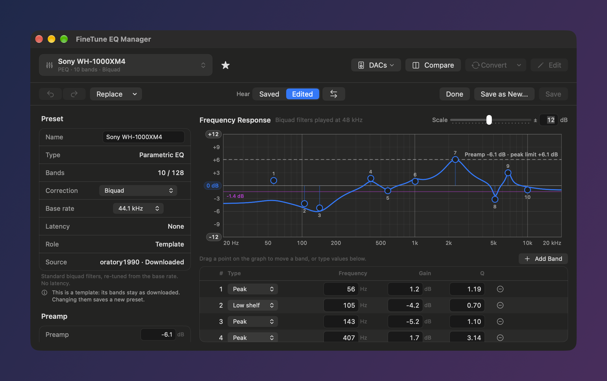
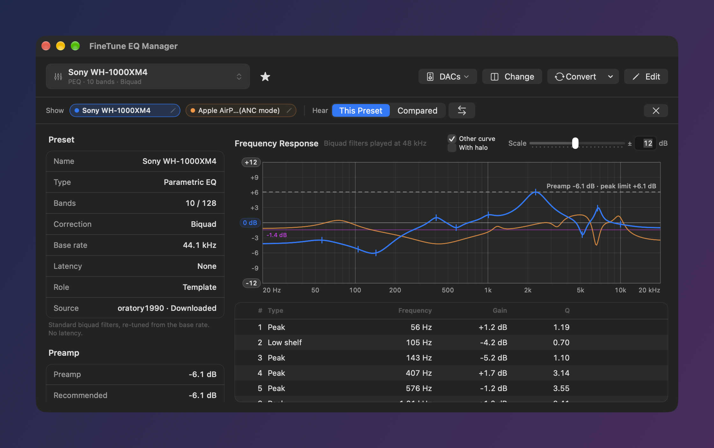

<h3>FineTune - ZebraPaw's Fork</h3>

Per-app volume, boost and routing, and an EQ for each output device that you build from top to bottom: parametric filters or GraphicEQ curves (the format of Wavelet and Equalizer APO), run as biquads or by convolution. Lives in your menu bar. Free and open-source.

<a href="https://github.com/MinecraftNerrd1337/FineTune/releases/latest/download/FineTune.dmg"></a>

<br clear="all"/>

<p align="center">
  <a href="https://github.com/MinecraftNerrd1337/FineTune/releases/latest"></a>
  <a href="https://github.com/MinecraftNerrd1337/FineTune/releases"></a>
  <a href="LICENSE"></a>
  <a href="https://www.apple.com/macos/"></a>
</p>

<p align="center">
  <strong>English</strong> · <a href="README.zh-CN.md">简体中文</a>
</p>

<p align="center">
  
</p>
<p align="center">
  
</p>

## What This Fork Adds

[FineTune](https://github.com/ronitsingh10/FineTune) by Ronit Singh already handles per-app volume and routing beautifully. I wanted more from the EQ side: to build and fine-tune corrections for my own headphones and DACs without leaving the menu bar. So this fork adds a full EQ editor, convolution engines, and a few things for DAC owners.

- **A real EQ editor** — The EQ Manager, below.
- **Convolution** — Presets can run as minimum-phase or linear-phase FIR filters, not only as biquads, and GraphicEQ curves play exactly as drawn.
- **Equalizer APO files, both ways** — Bring in a ParametricEQ.txt or GraphicEQ.txt from AutoEQ, Wavelet or Equalizer APO, and export your own presets back to them.
- **Real volume on DACs macOS can't control** — A small volume plugin speaks the DAC's own protocol, so the volume keys move the DAC's actual level instead of attenuating the signal. The first plugin is for iBasso DACs, and the [guide](guide/volume-plugins.md) shows how to write one for yours.
- **One correction per DAC** — When an app plays on several outputs at once, each output keeps its own AutoEQ preset and its own master volume.
- **A volume HUD that keeps up** — A Liquid Glass HUD on macOS 26, which also shows up when you turn the knob on the DAC itself, and stays where you're looking while macOS Zoom is on.

## EQ Manager

Open it from the sliders button at the top of the menu bar panel.

<p align="center">
  
</p>

### Build your presets band by band

Start from an empty preset or from one of thousands of headphone profiles, then shape it: drag a point on the graph, or type the exact frequency, gain and Q. Up to 128 bands (peak, low shelf, high shelf), a preamp, and the sample rate the filters were designed for. Rather work with a curve? A preset can also be a GraphicEQ curve, the format Wavelet and Equalizer APO use, so a curve made there plays here as is.

Profiles you download or import stay untouched as templates: changing one saves your version as a new preset.

### Hear it while you edit

Your changes play live on every device that uses the preset, before you save anything. Switch between **Saved** and **Edited** (or press ⌘B) to hear exactly what you changed.

### Compare two presets by ear

Put a second preset beside the first: both curves on one graph, and a click to switch which one you hear. FineTune matches their loudness on its own, so the louder one doesn't win just for being louder. You can edit either while comparing.

<p align="center">
  
</p>

### Choose how it's played

- **Biquad** — The classic parametric EQ. No latency.
- **Exact biquad** — The same filters, corrected so the top of the spectrum matches the curve you drew, whatever your DAC's sample rate. No latency.
- **Minimum-phase FIR** — The exact curve, by convolution, with the phase of an analog EQ. No latency.
- **Linear-phase FIR** — The exact curve with no phase change at all, for a little latency; you choose how precise it is.

### Convert, go back, export

- **Convert** a curve into bands, bands into a curve, a preset to fewer or more bands, or filters to another sample rate. FineTune tells you how far the result strays from the original.
- **History** keeps the versions each save replaces, so you can always go back.
- **Export...**, in a preset's right-click menu, saves it as a ParametricEQ.txt or GraphicEQ.txt.

All the details are in the [AutoEQ guide](guide/autoeq.md).

## Install

**Homebrew** (recommended)

```bash
brew install --cask finetune
```

**Manual** — [Download latest release](https://github.com/MinecraftNerrd1337/FineTune/releases/latest)

## Quick Start

1. Install FineTune and launch it from your Applications folder
2. Grant **Screen & System Audio Recording** permission when prompted
3. Click the FineTune icon in your menu bar. Apps playing audio appear automatically.

That's it. Adjust sliders, route audio, and explore EQ from the menu bar.

> **Tip:** Want FineTune to auto-switch to a specific device when you connect it? Open edit mode (pencil icon) and drag it above the built-in speakers. This is a one-time setup. Your preferred order is saved permanently.

## Features

### 🎚 Volume Control
- **Per-app volume** — Individual sliders and mute for each application
- **Per-app volume boost** — 2x / 3x / 4x gain presets
- **Pinned apps** — Keep apps visible in the menu bar even when they're not playing, so you can configure volume, EQ, and routing in advance
- **Ignore apps** — Completely disengage FineTune from specific apps. Tears down the audio tap so the app returns to normal macOS audio
- **Scroll-wheel volume** — Hover any slider in the popup, the HUD, or the EQ panel and scroll to adjust.

### ⌨️ Keyboard
- **Global volume hotkeys** — Bind your own keys to **App Volume Up**, **App Volume Down**, and **App Mute** from Settings → Shortcuts. The "app" is whichever is currently making sound, so volume-down while a YouTube tab plays behind a foreground Terminal turns down YouTube, not the terminal. If nothing is audible, the hotkey falls through to the frontmost app.
- **Toggle the popup from anywhere** — Bind a hotkey to **Toggle FineTune Popup** and the menu bar opens or closes on demand, including from full-screen apps.
- **Configurable step size** — Pick **Coarse / Normal / Fine / Extra-Fine** under Settings → Shortcuts → Volume Step. The same setting governs the F10–F12 media keys, the global hotkeys, and the popup's arrow-key navigation.
- **Hold to ramp, auto-unmute on volume-up** — Holding App Volume Up or Down emits repeats the way macOS does for arrow keys. Volume-up while muted unmutes and sets the new level in one keystroke.
- **Drive the popup with the keyboard** — Once the popup is open, **↑ / ↓** move between rows, **← / →** adjusts the focused row's volume (Shift = 2× step), **M** toggles mute, **Return / Space** activates, **Tab** switches between Output and Input device tabs, **Esc** closes. The focused row autoscrolls to center as you arrow through.

### 🔀 Audio Routing
- **Multi-device output** — Route audio to multiple devices simultaneously
- **Audio routing** — Send apps to different outputs or follow system default
- **Device priority** — Choose which device FineTune switches to when a new device connects; auto-fallback on disconnect
- **Auto-restore** — When a device reconnects, apps automatically return to it with their volume, routing, and EQ intact

### 🎛 EQ & Correction
- **EQ Manager** — Build each device's EQ band by band or as a curve, hear it live, compare presets by ear, and export them. See [EQ Manager](#eq-manager)
- **AutoEQ headphone correction** — Start from thousands of headphone profiles from the AutoEQ catalog, used as they are or as templates for your own presets
- **Per-app EQ** — A quick graphic EQ for each app, with 20 presets across 5 categories and your own presets
- **Loudness compensation** — Automatic bass and treble correction at low volumes using ISO 226:2023 equal-loudness contours, with real-time level management to keep perceived loudness consistent

### 🖥 Devices & System
- **Input device control** — Monitor and adjust microphone levels
- **Alert volume** — Control macOS notification and alert volume from settings
- **Smart volume backend** — FineTune auto-picks hardware, DDC, or software volume per device. If the hardware slider on a USB DAC or HDMI output doesn't actually control level, force software volume from the device inspector and FineTune remembers the choice for that device
- **Master volume per device** — A software volume on top of the output device's own hardware or DDC volume, remembered per device, to go quieter than its lowest step. The master slider above the apps sets it for the current output; hold ⌥ on any device's slider to set that device's without switching to it. It works like a software-backed device's volume, so it adds no processing step
- **Keep-alive per device** — For DACs that click or pop when playback starts or stops, FineTune can keep the device streaming silence at all times from its device inspector, so it never stops or goes to standby. The stream is supervised and rebuilt after sleep, reconnection or a format change
- **Device inspector** — Tap the info button on any device row for sample rate (with picker), transport, UID copy, hog-mode banner, and the software-volume override
- **Hide devices** — Eye toggle in edit mode hides output and input devices you don't want in the list, mirroring the app-hide flow
- **Bluetooth device management** — Connect paired devices directly from the menu bar
- **Monitor speaker control** — Adjust volume on external displays via DDC
- **Media keys & Volume HUD** — Opt-in F10–F12 control for the default output device, with a Tahoe-style or Classic-style on-screen HUD. The write goes through FineTune's volume pipeline, so keys keep working on USB interfaces and HDMI outputs where macOS's own keys are greyed out because the hardware slider is broken.
- **Dynamic menu bar icon** — Pick from four styles in Settings (Default, Speaker, Waveform, Equalizer). The **Speaker** style tracks volume live (zero / low / mid / high glyphs) and switches to a slashed speaker when muted. All styles briefly flash the new output's SF Symbol on device switch. Changing style applies instantly, no relaunch required.
- **Menu bar app** — Lightweight, always accessible
- **URL schemes** — Automate volume, mute, device routing, and more from scripts

### 🎨 Appearance
- **Light or Dark theme** — Settings → General → Theme matches macOS or locks FineTune to Light or Dark. The menu bar popup, every popover, and the volume HUD switch immediately.
- **Popup density** — Settings → General → Popup Size picks **Compact / Comfortable / Spacious** with a live tile preview. Compact fits more apps on small screens; Spacious gives bigger hit areas for trackpads.

## Documentation

- **[AutoEQ & Headphone Correction](guide/autoeq.md)** — Apply frequency correction from the [AutoEQ](https://github.com/jaakkopasanen/AutoEq) project, import [EqualizerAPO](https://sourceforge.net/projects/equalizerapo/) profiles, or browse [autoeq.app](https://www.autoeq.app/)
- **[Volume Plugins](guide/volume-plugins.md)** — Hardware volume for DACs whose level macOS can't set, through a small plugin that sends the DAC's own commands
- **[URL Schemes](guide/url-schemes.md)** — Automate FineTune from Terminal, [Shortcuts](https://support.apple.com/guide/shortcuts-mac), [Raycast](https://raycast.com), or scripts
- **[Troubleshooting](guide/troubleshooting.md)** — Permission issues, missing apps, audio problems

## Contributing

- **Star this repo** — Help others discover FineTune
- **Report bugs** — [Open an issue](https://github.com/MinecraftNerrd1337/FineTune/issues)
- **Contribute code** — See [CONTRIBUTING.md](CONTRIBUTING.md)

### Build from Source

```bash
git clone https://github.com/MinecraftNerrd1337/FineTune.git
cd FineTune
open FineTune.xcodeproj
```

## Requirements

- macOS 14.2 (Sonoma) or later
- Audio capture permission (prompted on first launch)

## License

[GPL v3](LICENSE)
