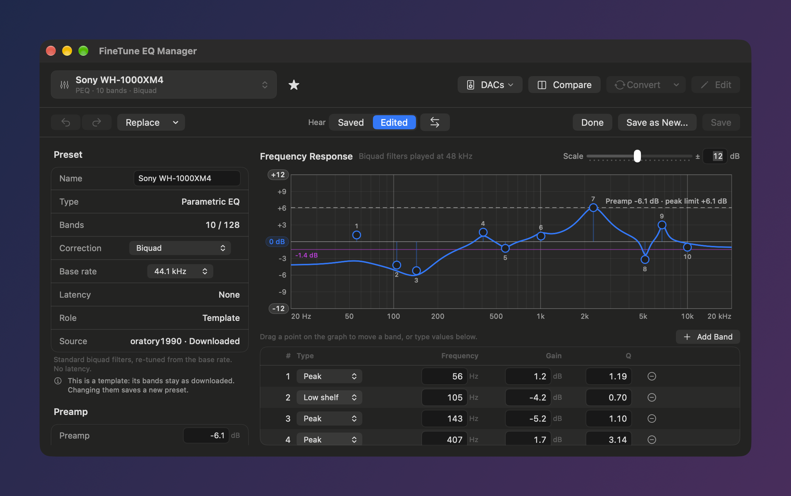
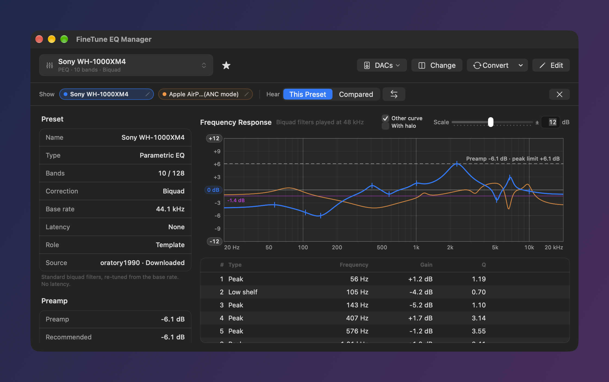

<h3>FineTune - ZebraPaw's Fork</h3>

按 App 调节音量、增益与路由，再为每台输出设备从头到尾打造自己的 EQ：参数滤波器或 GraphicEQ 曲线，以 Biquad 或卷积方式运行。常驻菜单栏，免费且开源。

<a href="https://github.com/MinecraftNerrd1337/FineTune/releases/latest/download/FineTune.dmg"></a>

<br clear="all"/>

<p align="center">
  <a href="https://github.com/MinecraftNerrd1337/FineTune/releases/latest"></a>
  <a href="https://github.com/MinecraftNerrd1337/FineTune/releases"></a>
  <a href="LICENSE"></a>
  <a href="https://www.apple.com/macos/"></a>
</p>

<p align="center">
  <a href="README.md">English</a> · <strong>简体中文</strong>
</p>

> 本翻译由社区维护，更新可能晚于英文版。最新内容请以 [English README](README.md) 为准。
> *This translation is community-maintained and may lag the English version. See the [English README](README.md) for the most current information.*

<p align="center">
  
</p>
<p align="center">
  
</p>

## 这个 Fork 新增了什么

Ronit Singh 的 [FineTune](https://github.com/ronitsingh10/FineTune) 在按 App 调节音量和路由方面已经做得很出色。我想在 EQ 上走得更远：不离开菜单栏，就能为自己的耳机和 DAC 打造并细调校正曲线。所以这个 fork 加入了完整的 EQ 编辑器、卷积引擎，以及一些为 DAC 用户准备的功能。

- **真正的 EQ 编辑器** —— 也就是下面介绍的 EQ 管理器。
- **卷积** —— 预设除了 Biquad，还可以用最小相位或线性相位 FIR 滤波器运行，GraphicEQ 曲线会完全按照画出的样子播放。
- **Equalizer APO 文件，导入导出都行** —— 导入来自 AutoEQ、Wavelet 或 Equalizer APO 的 ParametricEQ.txt、GraphicEQ.txt，也能把自己的预设导出回去。
- **为 macOS 控制不了的 DAC 提供真正的音量** —— 一个小小的音量插件使用 DAC 自己的协议，音量键调节的是 DAC 真实的音量，而不是衰减信号。第一个插件支持 iBasso 的 DAC，[指南](guide/volume-plugins.md)介绍了如何为你的 DAC 写一个。
- **每台 DAC 一套校正** —— 一个 App 同时在多台输出设备上播放时，每台设备保留自己的 AutoEQ 预设和主音量。
- **跟得上的音量 HUD** —— macOS 26 上的 Liquid Glass HUD，转动 DAC 本身的旋钮时也会出现，开启 macOS 缩放时会停在你正在看的位置。

## EQ 管理器

从菜单栏面板顶部的推子按钮打开。

<p align="center">
  
</p>

### 逐个频段打造预设

从一个空白预设开始，或者从数千条耳机曲线中的一条开始，然后慢慢塑造：在图上拖动一个点，或输入精确的频率、增益和 Q 值。最多 128 个频段（峰值、低架、高架），一个前级增益，以及滤波器设计时所用的采样率。更喜欢用曲线？预设也可以是一条 GraphicEQ 曲线。

下载或导入的配置会作为模板保持原样：修改它们会把你的版本另存为新预设。

### 边改边听

所有改动都会在使用该预设的每台设备上实时播放，无需先保存。在 **Saved** 和 **Edited** 之间切换（或按 ⌘B），就能听出你到底改了什么。

### 用耳朵对比两个预设

把第二个预设放在第一个旁边：两条曲线画在同一张图上，点一下就能切换正在听的那个。FineTune 会自动匹配两者的响度，响一点的那个不会仅仅因为更响而胜出。对比时两个预设都可以编辑。

<p align="center">
  
</p>

### 选择播放方式

- **Biquad** —— 经典的参数均衡器。无延迟。
- **精确 Biquad** —— 同样的滤波器，经过修正，让频谱顶端也和你画出的曲线一致，无论 DAC 的采样率是多少。无延迟。
- **最小相位 FIR** —— 用卷积精确还原曲线，相位特性与模拟 EQ 相同。无延迟。
- **线性相位 FIR** —— 精确还原曲线，完全不改变相位，代价是一点延迟；精度由你决定。

### 转换、回退、导出

- **转换**：把曲线变成频段、把频段变成曲线、增减预设的频段数，或把滤波器换到另一个采样率。FineTune 会告诉你结果与原版相差多少。
- **历史**：保留每次保存所替换的版本，随时可以回退。
- **导出...**：在预设的右键菜单中，将其存为 ParametricEQ.txt 或 GraphicEQ.txt。

所有细节见 [AutoEQ 指南](guide/autoeq.zh-CN.md)。

## 安装

**Homebrew**（推荐）

```bash
brew install --cask finetune
```

**手动安装** —— [下载最新版本](https://github.com/MinecraftNerrd1337/FineTune/releases/latest)

## 快速上手

1. 安装 FineTune，从「应用程序」文件夹中启动
2. 在系统弹出权限请求时，授予 **屏幕与系统音频录制** 权限
3. 点击菜单栏中的 FineTune 图标，正在播放音频的 App 会自动出现

就是这样。直接拖动滑块、切换音频路由，或在菜单栏里玩一下 EQ 即可。

> **小贴士：** 想让 FineTune 在某台设备接入时自动切换过去？打开编辑模式（铅笔图标），把它拖到内置扬声器上方即可。这是一次性设置，你的偏好顺序会被永久保存。

## 功能

### 🎚 音量控制
- **按 App 控制音量** —— 为每个应用提供独立的音量滑块和静音
- **按 App 增益** —— 提供 2x / 3x / 4x 三档增益预设
- **置顶 App** —— 即使应用没有在播放声音，也让它一直显示在菜单栏中，方便提前配置音量、EQ 和路由
- **忽略 App** —— 让 FineTune 完全脱离指定的应用，撤掉对应的音频接入点，让该应用回到 macOS 默认的音频通路
- **滚轮调节音量** —— 把鼠标悬停到弹窗、HUD 或 EQ 面板的任一滑块上，滚动滚轮即可调节

### ⌨️ 键盘
- **全局音量快捷键** —— 在 设置 → 快捷键 中，给 **App Volume Up**、**App Volume Down** 与 **App Mute** 自定义按键。这里的「App」指的是当前在发声的应用，所以当 YouTube 标签页在后台播放、终端在前台时，按下音量减只会调小 YouTube，不会动到终端。如果当前没有任何声音，快捷键会回退到最前台的应用
- **从任何地方唤起弹窗** —— 给 **Toggle FineTune Popup** 绑定一个快捷键，菜单栏弹窗就能随时开关，即便在全屏应用中也可以
- **可调节的步长** —— 在 设置 → 快捷键 → Volume Step 里选择 **Coarse / Normal / Fine / Extra-Fine**。这一项同时控制 F10–F12 媒体键、全局快捷键，以及弹窗里的方向键导航
- **长按连续调节、调高时自动取消静音** —— 长按 App Volume Up 或 Down 会像 macOS 的方向键一样持续触发；当处于静音状态按音量加，会一次性取消静音并设置到新音量
- **键盘操作弹窗** —— 弹窗打开后，**↑ / ↓** 在行间移动，**← / →** 调节当前焦点行的音量（按住 Shift = 2 倍步长），**M** 切换静音，**Return / Space** 触发，**Tab** 在「输出」与「输入」设备标签间切换，**Esc** 关闭。焦点行会自动滚动到中央

### 🔀 音频路由
- **多设备输出** —— 同时将音频送往多台设备
- **音频路由** —— 把不同 App 分发到不同输出，或随系统默认输出走
- **设备优先级** —— 当新设备接入时，自定义 FineTune 切换的目标；当设备断开时，自动回退
- **自动恢复** —— 设备重新接入后，相关 App 会自动回到这台设备，并保留原本的音量、路由与 EQ 设置

### 🎛 EQ 与校正
- **EQ 管理器** —— 逐个频段或用一条曲线打造每台设备的 EQ，实时试听，用耳朵对比预设，并可导出。见 [EQ 管理器](#eq-管理器)
- **AutoEQ 耳机校正** —— 以 AutoEQ 目录中的数千条耳机曲线为起点，可直接使用，也可作为你自己预设的模板
- **App EQ** —— 为每个 App 提供快速的图示均衡器，内置 5 大类、共 20 个预设，也可保存你自己的预设
- **响度补偿** —— 在低音量下，依据 ISO 226:2023 等响度曲线自动补偿低频和高频，并实时管理整体电平，让感知响度保持一致

### 🖥 设备与系统
- **输入设备控制** —— 监控并调节麦克风电平
- **提示音音量** —— 在设置中控制 macOS 通知与提示音的音量
- **智能音量后端** —— FineTune 会按设备自动选择硬件、DDC 或软件音量。如果某台 USB DAC 或 HDMI 输出的硬件滑块根本不起作用，可以在设备详情里强制使用软件音量，FineTune 会记住这台设备的选择
- **设备详情** —— 点击任一设备旁的信息按钮，可以看到采样率（含选择器）、连接方式、UID 复制、独占模式提示，以及软件音量覆盖开关
- **隐藏设备** —— 在编辑模式下用「眼睛」按钮把不想出现在列表里的输出或输入设备隐藏起来，逻辑与隐藏 App 一致
- **蓝牙设备管理** —— 直接从菜单栏连接已配对的设备
- **显示器扬声器控制** —— 通过 DDC 调节外接显示器的音量
- **媒体按键与音量提示** —— 可选地接管 F10–F12 来控制默认输出设备，并在屏幕上显示 Tahoe 风格或经典风格的音量提示。所有写入都会走 FineTune 的音量管线，因此即使在 macOS 自身因为硬件滑块不可用而把媒体键灰掉的 USB 接口或 HDMI 输出上，按键依然有效
- **动态菜单栏图标** —— 在「设置」中可选择四种风格（Default、Speaker、Waveform、Equalizer）。其中 **Speaker** 风格会随音量实时切换图标（零 / 低 / 中 / 高），静音时显示带斜线的扬声器；切换设备时，所有风格都会短暂闪现新输出对应的 SF Symbol。切换风格立即生效，无需重启
- **菜单栏应用** —— 轻量、随时可用
- **URL Scheme** —— 通过脚本自动化控制音量、静音、设备路由等

### 🎨 外观
- **浅色或深色主题** —— 设置 → 通用 → 主题 跟随 macOS，或将 FineTune 锁定为浅色 / 深色。菜单栏弹窗、所有浮窗以及音量提示会立即切换
- **弹窗密度** —— 设置 → 通用 → Popup Size 选择 **Compact / Comfortable / Spacious**，并提供实时预览。Compact 在小屏幕上能容纳更多 App；Spacious 给触控板用户更大的点击区域

## 文档

- **[AutoEQ 与耳机校正](guide/autoeq.zh-CN.md)** —— 应用来自 [AutoEQ](https://github.com/jaakkopasanen/AutoEq) 项目的频响校正、导入 [EqualizerAPO](https://sourceforge.net/projects/equalizerapo/) 配置，或浏览 [autoeq.app](https://www.autoeq.app/)
- **[URL Scheme](guide/url-schemes.md)** —— 通过终端、[快捷指令](https://support.apple.com/guide/shortcuts-mac)、[Raycast](https://raycast.com) 或脚本自动化 FineTune
- **[排查指引](guide/troubleshooting.md)** —— 权限问题、应用未出现、声音异常等

## 参与贡献

- **给本仓库点 Star** —— 帮助更多人发现 FineTune
- **报告 Bug** —— [新建 issue](https://github.com/MinecraftNerrd1337/FineTune/issues)
- **贡献代码** —— 见 [CONTRIBUTING.md](CONTRIBUTING.md)

### 从源码构建

```bash
git clone https://github.com/MinecraftNerrd1337/FineTune.git
cd FineTune
open FineTune.xcodeproj
```

## 系统要求

- macOS 14.2 (Sonoma) 或更高版本
- 音频采集权限（首次启动时弹出请求）

## 许可证

[GPL v3](LICENSE)
